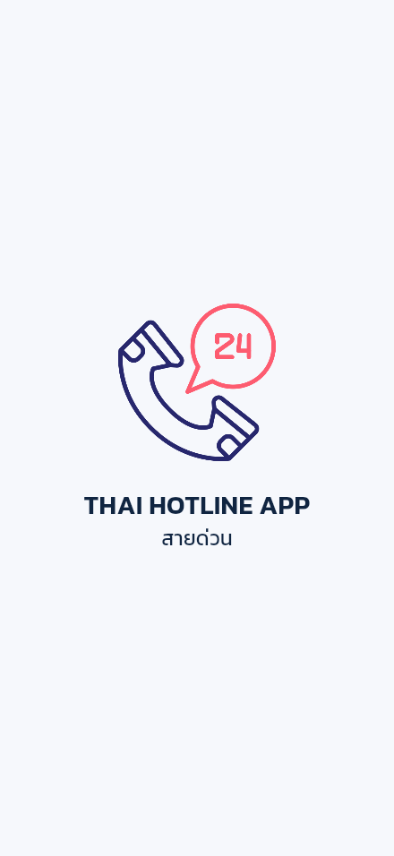
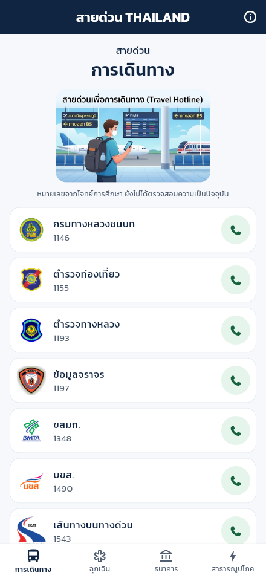
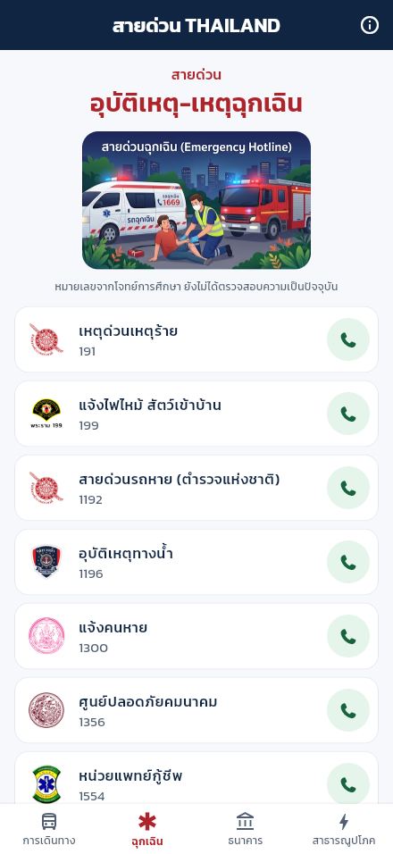
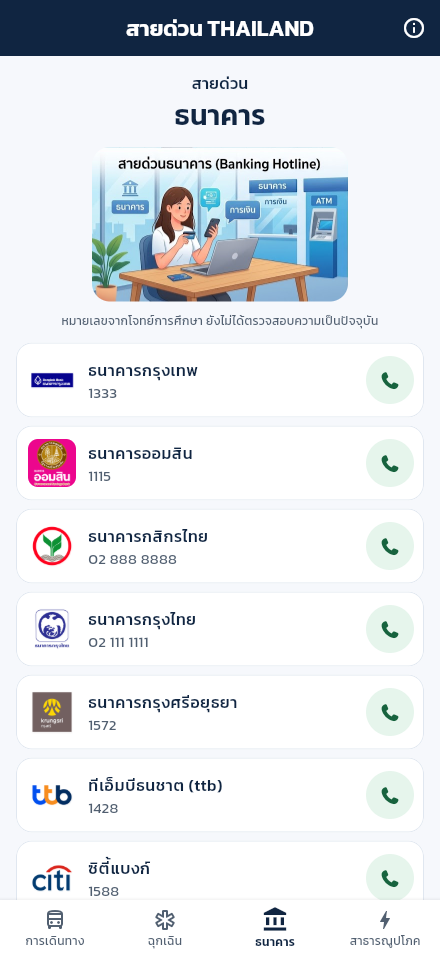
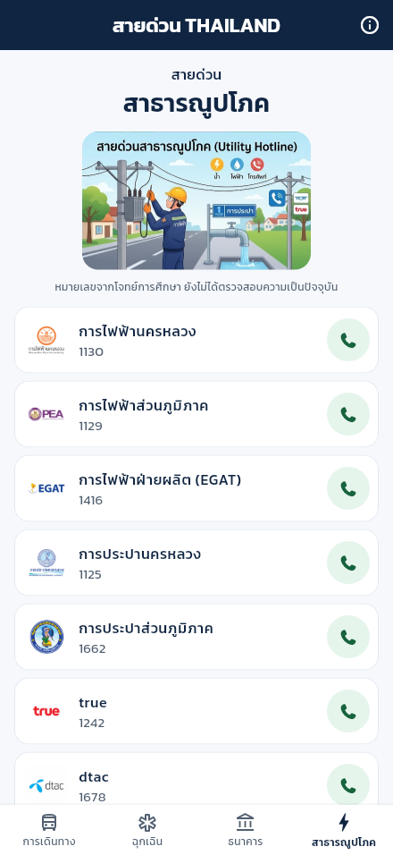
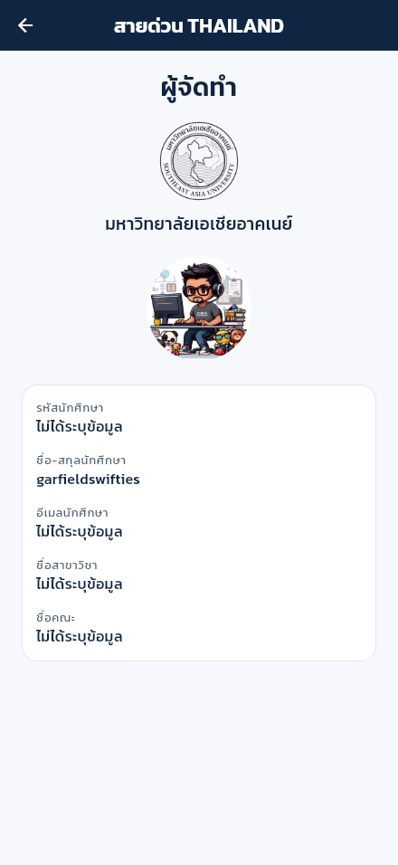

# สายด่วน THAILAND

สายด่วน THAILAND เป็นสมุดรายชื่อเบอร์ติดต่อภาษาไทยเพื่อการศึกษา พัฒนาด้วย Flutter และ Dart ผู้ใช้เลือกหมวดแล้วแตะรายการเพื่อเปิดหมายเลขในแอปโทรศัพท์ของอุปกรณ์

## ฟังก์ชันการทำงาน

- เริ่มที่หน้าต้อนรับประมาณ 3 วินาที จากนั้นเปิดหน้าหลัก
- เลื่อนดูหมายเลข 43 รายการใน 4 หมวด ได้แก่ การเดินทาง 9 รายการ ฉุกเฉิน 9 รายการ ธนาคาร 16 รายการ และสาธารณูปโภค 9 รายการ
- แตะแถวหรือไอคอนโทรศัพท์เพื่อเปิดแอปโทรศัพท์ผ่าน `tel:` หากระบบแจ้งว่าเปิดไม่ได้ แอปจะแสดงข้อความพร้อมหมายเลข
- เปิดหน้าผู้จัดทำจากไอคอนข้อมูลด้านขวาของแถบชื่อแอป

## ภาพหน้าจอแอปพลิเคชัน

ภาพจาก Web build ที่เปิดใน Chrome Headless ขนาด 440 × 956 logical pixels

| หน้าต้อนรับ | การเดินทาง | อุบัติเหตุ-เหตุฉุกเฉิน |
| :---: | :---: | :---: |
|  |  |  |

| ธนาคาร | สาธารณูปโภค | ผู้จัดทำ |
| :---: | :---: | :---: |
|  |  |  |

## เทคโนโลยีที่ใช้

| เทคโนโลยี | หน้าที่ |
| --- | --- |
| Flutter 3.50 และ Dart 3.14 | เฟรมเวิร์กและภาษาหลัก |
| `material_ui` 1.11.1 | Material widgets และข้อความระบบภาษาไทย |
| `url_launcher` 6.3.3 | ส่ง `tel:` ไปยังแอปภายนอก |
| `font_awesome_flutter` 11.0.0 | ไอคอนโทรศัพท์ |
| `flutter_launcher_icons` 0.14.4 | สร้างไอคอน Android, iOS และ Web |
| Kanit | ฟอนต์ภาษาไทยแบบฝังในแอป ใช้งานได้โดยไม่ต้องโหลดฟอนต์ขณะเปิดแอป |

## โครงสร้างโปรเจกต์

| ไฟล์ | Class | หน้าที่ |
| --- | --- | --- |
| `lib/main.dart` | `FlutterThaiHotlineApp` | ตั้งค่าแอป ภาษา และหน้าแรก |
| `lib/app_theme.dart` | — | กำหนดชื่อแอปและชุดสี |
| `lib/views/splash_screen_ui.dart` | `SplashScreenUI` | แสดงหน้าต้อนรับและเปิดหน้าหลัก |
| `lib/views/home_ui.dart` | `HomeUI` | สลับ 4 หมวดและเปิดหน้าผู้จัดทำ |
| `lib/views/travel_ui.dart` | `TravelUI` | แสดงสายด่วนการเดินทาง |
| `lib/views/emg_ui.dart` | `EmgUI` | แสดงสายด่วนอุบัติเหตุและเหตุฉุกเฉิน |
| `lib/views/bank_ui.dart` | `BankUI` | แสดงสายด่วนธนาคาร |
| `lib/views/pub_ui.dart` | `PubUI` | แสดงสายด่วนสาธารณูปโภค |
| `lib/views/about_ui.dart` | `AboutUI` | แสดงข้อมูลผู้จัดทำ |
| `lib/models/hotline.dart` | `Hotline` | เก็บข้อมูลสายด่วนและสร้าง URI โทรศัพท์ |
| `lib/models/hotline_data.dart` | — | เก็บรายการสายด่วนสี่หมวดในเครื่อง |
| `lib/widgets/hotline_list.dart` | `HotlineList` | แสดงรายการร่วมกันและเปิดแอปโทรศัพท์ |
| `assets/` | — | แบนเนอร์ โลโก้ ไอคอน รูปผู้จัดทำ และฟอนต์ |
| `test/widget_test.dart` | `FakePhoneLauncher` | จำลองการเปิดแอปโทรศัพท์ในชุดทดสอบข้อมูลและการนำทาง |

## การติดตั้งและใช้งาน

ใช้ Flutter SDK ที่รองรับ Dart `^3.14.0` ตาม `pubspec.yaml` เวอร์ชันที่ใช้ทดสอบคือ Flutter 3.50 ติดตั้ง Chrome แล้วรันคำสั่งจากโฟลเดอร์โปรเจกต์

```sh
flutter pub get
flutter run -d chrome
```

เลือกหมวดจากแถบด้านล่างและเลื่อนดูรายการ อุปกรณ์ต้องมีแอปที่รองรับ `tel:` จึงจะส่งหมายเลขไปยังแอปโทรศัพท์ได้

## การทดสอบและข้อจำกัด

> หมายเลขโทรศัพท์อ้างอิงจากโจทย์การศึกษาและยังไม่ได้ยืนยันความเป็นปัจจุบัน แอปนี้จัดทำเพื่อการศึกษาและไม่มีสถานะเป็นบริการทางการ

| รายการ | ผล |
| --- | --- |
| `flutter analyze` | ผ่านโดยไม่พบปัญหา |
| `flutter test` | ผ่าน 5 กรณี ครอบคลุมข้อมูล 43 รายการ การนำทาง หน้าผู้จัดทำ และการส่ง `tel:` แบบจำลอง รวมถึงกรณีเปิดไม่ได้ |
| Web build | สร้างสำเร็จ |
| Web runtime | ตรวจ UI ใน Chrome Headless ที่ 440 × 956, 430 × 932 และ 320 × 568 logical pixels |
| Android build | สร้าง debug APK สำเร็จและตรวจชื่อแอปกับไอคอนใน APK |
| Android runtime | ยังไม่ได้ติดตั้งหรือรันแอปบน Emulator หรืออุปกรณ์จริง |
| iOS | ตรวจไฟล์ไอคอนแล้ว ผล Build และการรันยังไม่ได้ทดสอบ |

- ชุดทดสอบจำลองการส่งเบอร์โดยไม่มีการเปิด Dialer จริงหรือโทรออก บน Web การเปิดแอปโทรศัพท์ขึ้นอยู่กับเบราว์เซอร์และแอปที่อุปกรณ์รองรับ
- หน้าผู้จัดทำแสดงชื่อบัญชีและภาพ Avatar โดยใช้ข้อความแทนข้อมูลส่วนบุคคล เช่น ชื่อจริง รหัสนักศึกษา และอีเมล

## เครดิตและสิทธิ์การใช้งาน

### ทรัพยากรจากอาจารย์และ Figma

หน้าจออ้างอิงแบบใน Figma ส่วนข้อมูลและภาพประกอบมาจากชุดทรัพยากรที่อาจารย์จัดเตรียมให้สำหรับรายวิชาการพัฒนาโปรแกรมประยุกต์สำหรับอุปกรณ์เคลื่อนที่ มหาวิทยาลัยเอเชียอาคเนย์ [Figma ของรายวิชา](https://www.figma.com/design/sadTijq8cG1Mi6a8hu87fs/Mobile-App--flutter_thai_hotline_app?node-id=7007-158)

### ฟอนต์ แพ็กเกจ และสัญญาอนุญาตโอเพนซอร์ส

- Kanit โดย The Kanit Project Authors ใช้ SIL Open Font License 1.1 [ไฟล์สัญญาอนุญาต](assets/fonts/OFL.txt)
- Flutter, Dart, Material UI, URL Launcher และ Flutter Lints ใช้ BSD 3-Clause ส่วน Flutter Launcher Icons และตัวแพ็กเกจ Font Awesome Flutter ใช้ MIT โดยไอคอน Font Awesome Free ใช้ CC BY 4.0 และไฟล์ฟอนต์ใช้ SIL OFL 1.1 ดูรายละเอียดที่ [Flutter](https://github.com/flutter/flutter/blob/master/LICENSE), [Dart](https://github.com/dart-lang/sdk/blob/main/LICENSE), [Material UI](https://pub.dev/packages/material_ui/license), [URL Launcher](https://pub.dev/packages/url_launcher/license), [Flutter Lints](https://pub.dev/packages/flutter_lints/license), [Flutter Launcher Icons](https://pub.dev/packages/flutter_launcher_icons/license), [Font Awesome Flutter](https://pub.dev/packages/font_awesome_flutter/license) และ [Font Awesome Free](https://fontawesome.com/license/free)

### ทรัพยากรและเครื่องหมายการค้าของบุคคลที่สาม

ตรามหาวิทยาลัย โลโก้หน่วยงานและธนาคาร แบนเนอร์ ไอคอน และ Avatar การ์ตูนมาจากชุด Resources ของรายวิชาและใช้เพื่อการศึกษา สิทธิ์ในเครื่องหมายการค้าเป็นของเจ้าของแต่ละราย ผู้สร้างและสิทธิ์เผยแพร่ซ้ำของ Avatar และภาพประกอบยังไม่ได้รับการยืนยัน
